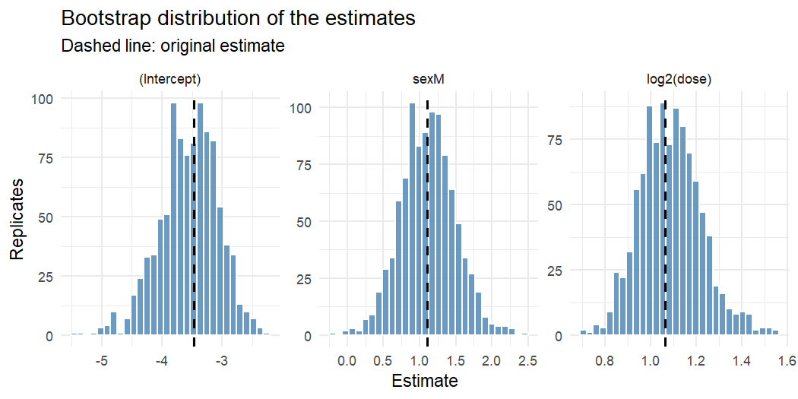
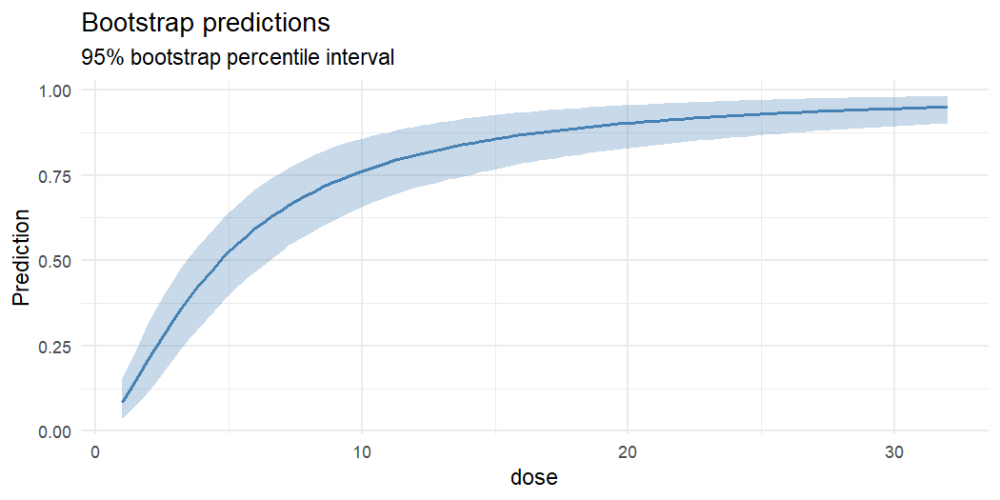

<!-- README.md is generated from README.Rmd. Please edit that file and run devtools::build_readme(). -->

# parametricboot

<!-- badges: start -->

[](https://github.com/DiogoRibeiro7/parametricboot/actions/workflows/R-CMD-check.yaml)
[](https://app.codecov.io/gh/DiogoRibeiro7/parametricboot)
[](https://lifecycle.r-lib.org/articles/stages.html#experimental)
[](LICENSE.md)
<!-- badges: end -->

parametricboot automates the **parametric bootstrap** for fitted
regression models. You fit a model as usual; the package simulates new
responses from it, refits the model to each of them, and turns the
replicates into bias estimates, standard errors, confidence intervals,
prediction intervals, likelihood-ratio tests and diagnostic plots.

Supported models:

| Model | Fitted with | How replicates are generated |
|----|----|----|
| Linear and generalised linear models | `lm()`, `glm()` | `simulate()`, then the original call is re-evaluated |
| Negative-binomial regression | `MASS::glm.nb()` | `MASS::simulate.negbin()` with fitted theta; re-estimate theta on each refit |
| Linear and generalised linear mixed models | `lme4::lmer()`, `lme4::glmer()` | `simulate()`, then `lme4::refit()` |
| Cox proportional hazards models | `survival::coxph()` | model-based resampling (Davison & Hinkley, 1997, Algorithm 7.3) |

## Validated model classes

The base-R `lm()` and `glm()` classes use the validated linear-model/GLM
bootstrap engine. Inheriting from `lm` or `glm` is not, by itself, a
guarantee that simulating and refitting preserves a model's assumptions:
unvalidated subclasses such as `mgcv::gam()` and `stats::aov()`
fail explicitly rather than returning unverified bootstrap results.
The exact `MASS::glm.nb()` class is now separately supported: response
simulation uses the fitted negative-binomial mean and dispersion, and
refitting re-estimates dispersion in each replicate. Non-unit prior weights
remain unsupported because `simulate.negbin()` ignores them. Quasi-likelihood families are also rejected because
they lack a fully specified parametric sampling law.

The supported `lme4` mixed models and right-censored `coxph` workflows
are unaffected. Additional model classes will be admitted after separate
mathematical and computational validation.

## Installation

parametricboot is a work in progress: it is not on CRAN, and the
interface may still change. Install the development version from GitHub:

``` r
# install.packages("pak")
pak::pak("DiogoRibeiro7/parametricboot")
```

## Memory-efficient bootstrap predictions

Supply `newdata` when bootstrapping to store one numeric prediction per row per successful refit, without keeping refitted model objects. Use `predict_args` to set prediction options explicitly. The cached request is checked so that a later call cannot silently return predictions for different inputs.

```r
fit <- lm(mpg ~ wt + hp, data = mtcars)
new_cars <- mtcars[1:3, c("wt", "hp")]
boot <- pb_simulate(fit, n = 100, seed = 2, keep_fits = FALSE,
                    newdata = new_cars)
quantiles <- t(apply(pb_predict_boot(boot), 1, stats::quantile,
                     probs = c(0.025, 0.975)))
```

This caches conditional mean predictions rather than predictive intervals for a new observation; the latter also require response noise.

## Derived statistics

You can bootstrap a named statistic of any supported fitted model, such as an
odds ratio, slope contrast or threshold. The same summaries and non-studentised
intervals apply. The default coefficient workflow is unchanged.

```r
model <- glm(vs ~ mpg, data = mtcars, family = binomial())
boot <- pb_simulate(model, n = 200, seed = 1, keep_fits = FALSE,
                    statistic = function(fit) c(odds_ratio = exp(coef(fit)[[2L]])))
pb_confint(boot, type = "percentile")
pb_mc_error(boot)
```

Studentised intervals for a derived statistic are available when a
`statistic_se(fit)` callback provides a matching, strictly positive,
model-justified standard error on every refit. For example, the delta method
supplies the standard error of a GLM odds ratio:

```r
s <- function(fit) c(odds_ratio = unname(exp(coef(fit)[[2L]])))
s_se <- function(fit) {
  beta <- unname(coef(fit)[[2L]])
  c(odds_ratio = exp(beta) * sqrt(unname(vcov(fit)[2, 2])))
}
boot <- pb_simulate(model, n = 200, seed = 1, keep_fits = FALSE,
                    statistic = s, statistic_se = s_se)
pb_confint(boot, type = "student")
```

Without that callback, studentised derived-statistic intervals remain
unavailable. The package checks callback structure and positivity, not the
mathematical correctness of a supplied standard error.

## Goodness-of-fit checks

`pb_gof()` compares a deviance, Pearson statistic or count of zeros with
the simulated, refitted reference distribution of a supported binomial or
count regression model. The default `tail = "greater"` identifies unusually
large discrepancies or excess zeros; `tail = "less"` tests for unusually
few zeros or small discrepancy values.

```r
counts <- data.frame(y = c(0, 0, 1, 1, 2, 2, 0, 1, 1, 2))
model <- glm(y ~ 1, data = counts, family = poisson())
check <- pb_gof(model, n = 200, statistic = "zeros",
                tail = "less", seed = 1)
pb_gof_mc_error(check)
pb_plot_gof(check)
```

The Monte Carlo limits describe simulation uncertainty in the tail
probability, conditional on the fitted model and successful refits; they
do not establish whether the model is correctly specified.

## Monte Carlo precision of bootstrap summaries

The functions `pb_mc_error()` and `pb_confint_mc_error()` quantify how much
a finite number of successful bootstrap replicates affects the estimated bias,
bootstrap standard error and the limits of percentile, basic or studentised
confidence intervals. Interval limit diagnostics use conservative binomial
order-statistic ranks; they may be unbounded when the number of simulations
is too small. These are per-endpoint Monte Carlo bounds, not confidence
intervals for the unknown model parameter. For normal-approximation intervals,
Monte Carlo precision uses a joint delta method retaining covariance between
the simulated mean and standard deviation; those bounds are approximate.

```r
model <- lm(mpg ~ wt, data = mtcars)
sim <- pb_simulate(model, n = 100, seed = 42, keep_fits = FALSE)
pb_mc_error(sim)
pb_confint_mc_error(sim, level = 0.8, mc_level = 0.9)
```

## Monte Carlo precision for bootstrap tests

A bootstrap p-value depends on how many successful refits were simulated.
`pb_lrt_mc_error()` reports its binomial Monte Carlo standard error and an
exact interval for the bootstrap exceedance probability. It retains the
add-one corrected p-value reported by `pb_lrt()`; the interval refers
to simulation variability, not model uncertainty. Failed refits are counted
and excluded, so selective refit failure remains a potential source of bias.

```r
null <- lm(mpg ~ wt, data = mtcars)
alternative <- update(null, . ~ . + hp)
test <- pb_lrt(null, alternative, n = 199, seed = 1)
pb_lrt_mc_error(test)
```

## Structured input validation

Shared argument checks for bootstrap counts, seeds, confidence levels, bootstrap
results and parameter selection now raise native R `dataexcept` conditions.
They retain their existing error messages, gain a
`parametricboot_validation_error` class, and classify invalid unchanged inputs
as permanently non-retryable. This does not change the simulation algorithms,
statistical results, or how refit failures and warnings are handled.

```r
fit <- stats::lm(mpg ~ wt, data = mtcars)
error <- tryCatch(pb_simulate(fit, n = 0), error = identity)
inherits(error, "parametricboot_validation_error") # TRUE
dataexcept::is_retryable(error)                  # FALSE
```

Until `dataexcept` is published to a package repository, the development
installation resolves its exact pinned GitHub revision via `DESCRIPTION`.

## Example

A classic dose-response experiment (Collett, 1991): batches of 20
tobacco budworm moths of each sex were exposed to six doses of a
pyrethroid, and the number killed was recorded. That is only 12 binomial
observations, so how far can the large-sample theory behind
`summary(fit)` be trusted?

``` r
library(parametricboot)

budworm <- data.frame(
  sex = rep(c("M", "F"), each = 6),
  dose = rep(c(1, 2, 4, 8, 16, 32), times = 2),
  dead = c(1, 4, 9, 13, 18, 20, 0, 2, 6, 10, 12, 16),
  n = 20
)
fit <- glm(cbind(dead, n - dead) ~ sex + log2(dose), data = budworm, family = binomial())

res <- pb_simulate(fit, n = 1000, seed = 2025)
res
#> <pb_boot> Parametric bootstrap
#>   Model:      glm (binomial)
#>   Replicates: 1000
#>   Terms:      (Intercept), sexM, log2(dose)
```

`pb_summary_table()` reports, for each coefficient, the bootstrap
estimates of bias, standard error and mean squared error, the actual
coverage of the nominal 95% Wald interval, and a bootstrap confidence
interval:

``` r
pb_summary_table(res)
#>          term  estimate boot_mean        bias std_error        mse coverage
#> 1 (Intercept) -3.473155 -3.552493 -0.07933778 0.4839494 0.24026729    0.954
#> 2        sexM  1.100743  1.117377  0.01663401 0.3784177 0.14333343    0.945
#> 3  log2(dose)  1.064214  1.088388  0.02417447 0.1352250 0.01885192    0.946
#>        lower     upper
#> 1 -4.5809602 -2.702189
#> 2  0.4015961  1.856280
#> 3  0.8444751  1.401441
```

Here the news is good: the slope is overestimated by about 2%, a small
fraction of its standard error, and the Wald intervals cover as
advertised. The bootstrap distributions are close to normal:

``` r
pb_plot_estimates(res)
```



The same replicates give intervals for any prediction, here the
dose-response curve for male moths:

``` r
males <- data.frame(sex = "M", dose = seq(1, 32, length.out = 100))
pb_plot_predictions(res, males, x = "dose", type = "response")
```



## Functions

| Task | Functions |
|----|----|
| Draw replicates | `pb_simulate()`, `pb_parallel()`, `pb_drop_warned()` |
| Summarise | `pb_summary_table()`, `pb_key_stats()`, `pb_confint()`, `pb_tidy()`, plus `print()`, `summary()` and `confint()` methods |
| Visualise | `pb_plot_estimates()`, `pb_plot_diagnostics()`, `pb_plot_predictions()` |
| Predict | `pb_predict_boot()` |
| Test nested models | `pb_lrt()`, `pb_plot_lrt()` |
| Compare other models | `pb_compare_models()` |
| Nonparametric helper | `pb_resample()` |

The [getting-started
article](https://diogoribeiro7.github.io/parametricboot/articles/parametricboot.html)
(`vignette("parametricboot")`) is a tour that also covers mixed models,
Cox models, bootstrap likelihood-ratio tests, and what to do when some
refits misbehave. The full [function
reference](https://diogoribeiro7.github.io/parametricboot/reference/) is
on the package website.

## Getting help and contributing

Please report bugs and request features on the [issue
tracker](https://github.com/DiogoRibeiro7/parametricboot/issues).
Contributions are welcome; see the [contributing
guide](.github/CONTRIBUTING.md). This project follows a [code of
conduct](CODE_OF_CONDUCT.md).

## Citation

    Ribeiro D (2026). _parametricboot: Parametric Bootstrap for Fitted
    Regression Models_. R package version 0.0.0.9000,
    <https://github.com/DiogoRibeiro7/parametricboot>.

## License

MIT © Diogo Ribeiro. See [LICENSE.md](LICENSE.md).
